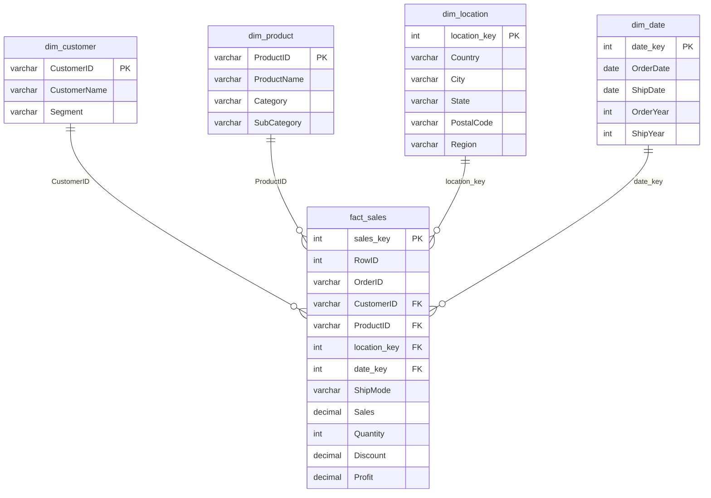

# Central Superstore – SQL Data Warehouse & Sales Analytics

An end-to-end analytics project built on the **Central Superstore** retail dataset: raw CSV → layered SQL Server data warehouse (medallion architecture) → star schema → business queries, KPI view/stored procedure → **Tableau dashboards**.


<!-- Replace with your best dashboard screenshot -->

---

## Key Business Findings

| Area | Finding |
|---|---|
| **Profitability** | Furniture is the only category losing money (**-1.77% margin**, -$2,894.75) even though its sales ($163.8K) are close to Technology's ($170.4K). Technology has the best margin (**16.85%**). |
| **Profitability** | **722 line items** were sold at a loss, concentrated in copier / binding-equipment products – the same products that rank among the top sellers. First Class shipping carries the highest average discount (**26.6%**), a likely driver. |
| **Customer behavior** | The top customer (Tamara Chand, $18.4K) generates ~50% more revenue than the #2 customer. Consumers buy mostly Office Supplies; Corporate and Home Office buy mostly Technology. |
| **Sales trends** | Monthly sales are highly volatile, with a recurring peak in September (e.g., Sep 2013: $34.4K). |

Full analysis and every query result: [`docs/PROJECT_DOCUMENTATION.md`](docs/PROJECT_DOCUMENTATION.md).

---

## Architecture

```
Central_Superstore.csv
        │  BULK INSERT
        ▼
   staging   – raw text, loaded as-is
        │  append new rows only (EXCEPT)
        ▼
   bronze    – raw history + identity key
        │  trim, type-cast, deduplicate, MERGE, quality flags
        ▼
   silver    – clean, typed, one row per RowID
        │  dimensional modeling
        ▼
   gold      – star schema → queries, KPI view, stored procedure → Tableau
```

### Gold layer – star schema



`dim_date` stores **both the order date and the ship date in one row** (one row per distinct order/ship date pair), so `fact_sales` needs only a single `date_key`. Month, quarter, weekday, etc. attributes exist for both dates (the diagram shows only a subset).

---

## What's Inside

| Component | Details |
|---|---|
| **ETL** | Staging → Bronze → Silver using CTEs, `MERGE`, `TRY_CAST`, `ROW_NUMBER` deduplication |
| **Data-quality flags** | `has_missing_value`, `has_invalid_value`, `has_outlier_value` (IQR method) via `CASE` |
| **Star schema** | 1 fact + 4 dimensions with enforced primary/foreign keys |
| **15 business queries** | JOINs, subqueries (incl. correlated), CTEs, window functions (`LAG`, `RANK`, `ROW_NUMBER`) |
| **View** | `gold.category_kpi` – sales, profit, quantity and margin % per category |
| **Stored procedure** | `gold.usp_get_region_kpi @Region` – KPI summary for one or all regions |
| **Indexes** | 5 non-clustered indexes on the fact table's join columns, created after load |
| **Dashboards** | Tableau workbook + screenshots (see below) |

---

## Repository Structure

```
.
├── README.md
├── sql/
│   └── retail_final.sql              # full pipeline: schemas, ETL, star schema, queries, view, procedure
├── data/
│   └── Central_Superstore.csv        # source dataset
├── tableau/
│   └── Central_Superstore_Dashboards.twbx
└── docs/
    ├── PROJECT_DOCUMENTATION.md      # detailed walkthrough of everything built
    └── images/                       # dashboard screenshots, diagrams
```

---

## How to Run

**Requirements:** SQL Server (Express is enough) and a client such as SSMS, Azure Data Studio, or VS Code with the MSSQL extension.

1. Clone the repository.
2. Open `sql/retail_final.sql` and update the `BULK INSERT` path to where `Central_Superstore.csv` is on your machine:
   ```sql
   FROM 'C:\path\to\Central_Superstore.csv'
   ```
3. Run the script from top to bottom. It creates the `central_dw` database, the four layers, and all gold objects.
4. Try the KPI objects:
   ```sql
   SELECT * FROM gold.category_kpi;

   EXEC gold.usp_get_region_kpi;                      -- all regions
   EXEC gold.usp_get_region_kpi @Region = 'Central';  -- one region
   ```
5. The 15 business queries are in the *"15 Query"* section of the script; run them one at a time.

---

## Dashboards (Tableau)

Workbook: [`tableau/Central_Superstore_Dashboards.twbx`](tableau/Central_Superstore_Dashboards.twbx)

<!-- Add one screenshot + one-line caption per dashboard -->


*Caption: what this dashboard shows.*


*Caption: what this dashboard shows.*

---

## Limitations

- The dataset contains the **Central region only**, so cross-region comparisons (and query Q11, "customers who never ordered in the West") are not meaningful until the East/South/West files are loaded.
- Outliers are **flagged**, not removed, so analysts can decide how to treat them.

## Tech Stack

SQL Server (T-SQL) · Tableau · Git

## Author

*Kirollos Gadallah* – (www.linkedin.com/in/kirollos-gadallah-ab5748348

) · [[GitHub](https://github.com/kirogadallah)]
