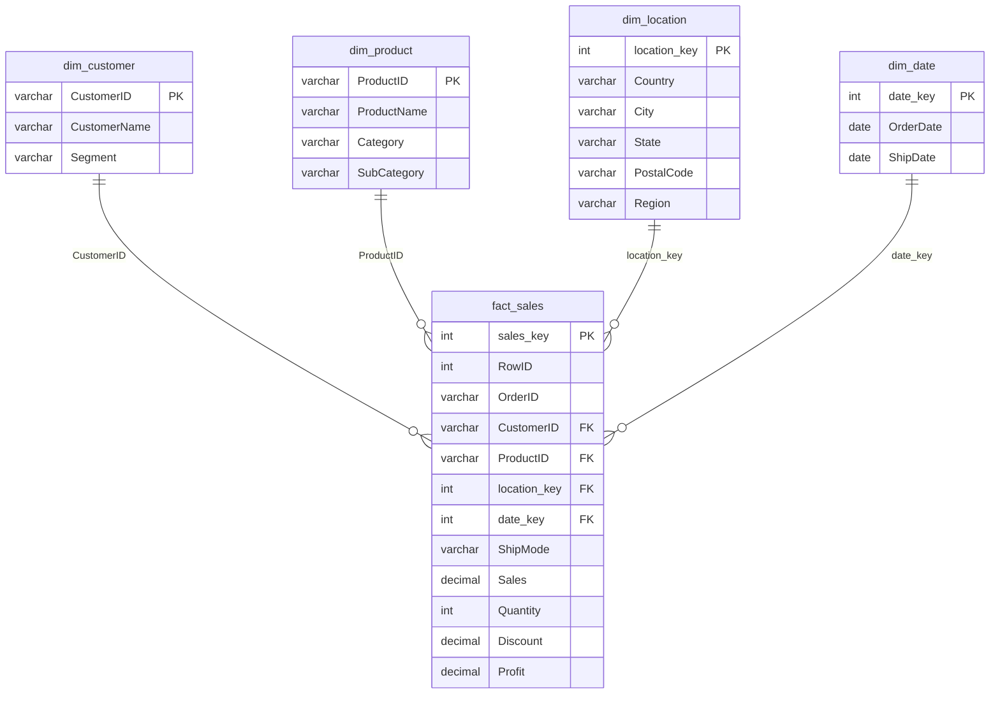

# Central Superstore – SQL Data Warehouse & Sales Analytics


An end-to-end analytics project: a raw retail CSV is loaded into a **layered SQL Server data warehouse** (staging → bronze → silver → gold), modeled as a **star schema**, analyzed with advanced T-SQL, and presented through **four interactive Tableau dashboards** and a Tableau Story.

**▶ [Explore the live dashboards on Tableau Public](https://public.tableau.com/app/profile/kirollos.gadallah/viz/CentralRetailDataset/ProductCategoryProfitability)**


## Team

| Member                                                        | Contribution                                                                                                                             |
| ------------------------------------------------------------- | ---------------------------------------------------------------------------------------------------------------------------------------- |
| **[Kirollos Gadallah](https://github.com/kirogadallah)** | SQL data warehouse (all four layers, star schema, queries, view, stored procedure), *Sales & Profit Overview* dashboard, Tableau Story |
| **[Mariam Emad](https://github.com/mmariaam)**                                         | *Product & Category Profitability* dashboard                                                                                           |
| **[Laila Elsisi](https://github.com/lailaahmedelsisi-glitch)**                                        | *Discounting & Margin Impact* dashboard                                                                                                |
| **[Basmala Essam](https://github.com/basmala5essam)**                                       | *Customer & Fulfillment Insights* dashboard                                                                                            |

Each team member first built an individual data warehouse; this repository contains Kirollos's implementation, which the shared Tableau workbook is connected to.

> Developed under the supervision of **Eng. Waleed Mohamed** as part of the **Digital Egypt Pioneers Initiative (DEPI)**.

---

## Key Insights

| Area                            | Insight                                                                                                                                                                                                                                |
| ------------------------------- | -------------------------------------------------------------------------------------------------------------------------------------------------------------------------------------------------------------------------------------- |
| **Profitability**         | Furniture is the only loss-making category (**−$2.9K, −1.77% margin**) despite $163.8K in sales. Technology earns the best margin (**16.85%**); Office Supplies earns 5.15%.                                             |
| **Product mix**           | 7 of 17 sub-categories lose money. **Copiers** lead profit ($15.5K); **Furnishings, Tables and Appliances** are the biggest drains (−$3.8K, −$3.0K, −$2.6K).                                                            |
| **Discounting**           | Profit peaks at **$71.6K with no discount** and turns negative at roughly a 30% discount. The five most-discounted sub-categories (Binders 51%, Appliances 45%, Furnishings 40%, Machines 33%, Tables 26%) are all unprofitable. |
| **Loss-making orders**    | **722 order lines** were sold at a loss. First Class shipments carry the highest average discount (**26.6%**).                                                                                                             |
| **Year-over-year (2016)** | Sales were flat vs 2015 (−0.22%) but profit fell **74.5%** to about $5K.                                                                                                                                                        |
| **Customers**             | Average order value is similar across segments ($409–$454), but profit per customer is **$16.7 for Consumers** vs **$92.7–$98.6 for Home Office and Corporate**.                                                         |
| **Fulfillment**           | Average shipping time: Standard 5.0 days, Second Class 3.4, First Class 2.2, Same Day ~0.                                                                                                                                              |

Detailed analysis, with the queries behind each finding: [`docs/PROJECT_DOCUMENTATION.md`](docs/PROJECT_DOCUMENTATION.md).

---

## Architecture

```
Central_Superstore.csv
        │  BULK INSERT
        ▼
  staging   raw text, loaded as-is
        │  append only new rows (EXCEPT)
        ▼
  bronze    raw history + identity key
        │  trim · type-cast · deduplicate · MERGE · data-quality flags
        ▼
  silver    clean, typed, one row per RowID
        │  dimensional modeling
        ▼
  gold      star schema ─► business queries · KPI view · stored procedure ─► Tableau
```

### Gold layer – star schema



`dim_date` holds **both the order date and the ship date in a single row** (one row per distinct order/ship date pair), so `fact_sales` needs only one `date_key`. Day, month, quarter, year and weekday attributes exist for both dates; the diagram shows only a subset.

---

## What's Inside

| Component                  | Details                                                                                                                  |
| -------------------------- | ------------------------------------------------------------------------------------------------------------------------ |
| **ETL**              | Staging → Bronze → Silver using CTEs, `MERGE`, `TRY_CAST`, and `ROW_NUMBER` de-duplication                       |
| **Data quality**     | `has_missing_value`, `has_invalid_value`, `has_outlier_value` (IQR method) flags built with `CASE`               |
| **Star schema**      | 1 fact table + 4 dimensions with enforced primary and foreign keys                                                       |
| **Business queries** | 15 queries using JOINs, subqueries (including correlated), CTEs and window functions (`LAG`, `RANK`, `ROW_NUMBER`) |
| **View**             | `gold.category_kpi` – sales, profit, quantity and margin % per category                                               |
| **Stored procedure** | `gold.usp_get_region_kpi @Region` – KPI summary for one or all regions                                                |
| **Optimization**     | 5 non-clustered indexes on the fact table's join columns, created after the load                                         |
| **Dashboards**       | 4 Tableau dashboards + Story, with year comparison, filters and navigation                                               |

---

## Dashboards

The workbook is built on the gold layer and includes a **Select Year** parameter (2013–2016) that drives every current-year vs previous-year comparison, plus a collapsible filter panel (Segment, Ship Mode, Category, Sub-Category, State, City).

### 1. Sales & Profit Overview — *Kirollos Gadallah*

KPI cards with year-over-year change, weekly sales and profit trends, performance by category, and a profitability map by state.


### 2. Product & Category Profitability — *Mariam Emad*

Profit by sub-category, top 10 most profitable products, monthly profit-margin trend by category, and a sales treemap by sub-category.


### 3. Discounting & Margin Impact — *Laila Elsisi*

How discount depth affects profit, average discount by sub-category, margin with vs without discount by state, and the biggest loss-making order lines.


### 4. Customer & Fulfillment Insights — *Basmala Esam*

Top 10 customers, segment performance (average order value, orders per customer, profit per customer), shipping time and order volume by ship mode, and customer geography.


<details>
<summary>Filter panel (Overview dashboard)</summary>

.png>)

</details>

---

## Repository Structure

```
.
├── README.md
├── SQL/
│   └── retail.sql                    # full pipeline: ETL, star schema, 15 queries, view, procedure
├── Tableau/
│   └── Mini Project Tableau.twbx     # packaged workbook (dashboards + story + data extract)
├── data/
│   └── Central_Superstore.csv        # source dataset
└── docs/
    ├── PROJECT_DOCUMENTATION.md      # detailed walkthrough of the whole project
    └── images/                       # dashboard screenshots
```

---

## How to Run

**Requirements:** SQL Server (Express edition is enough), a SQL client (SSMS, Azure Data Studio, or VS Code with the MSSQL extension), and Tableau Desktop to edit the workbook.

1. Clone the repository.
2. Open `SQL/retail.sql` and update the `BULK INSERT` path to the location of `Central_Superstore.csv` on your machine.
3. Run the script from top to bottom. It creates the `central_dw` database, the four layers, and all gold-layer objects.
4. Try the KPI objects:
   ```sql
   SELECT * FROM gold.category_kpi;

   EXEC gold.usp_get_region_kpi;                      -- all regions
   EXEC gold.usp_get_region_kpi @Region = 'Central';  -- a single region
   ```
5. Open `Tableau/Mini Project Tableau.twbx`. It ships with a data extract and opens offline. To refresh it, connect to server `localhost\SQLEXPRESS`, database `central_dw`, schema `gold`.

---

## Limitations

- The dataset covers the **Central region only**, so cross-region comparisons are not possible until the other regional files are loaded.
- Outliers are **flagged, not removed**, leaving the treatment decision to the analyst.
- The `BULK INSERT` path in the SQL script is machine-specific and must be edited before running.

---

## Tech Stack

SQL Server (T-SQL) · Tableau · Git & GitHub
