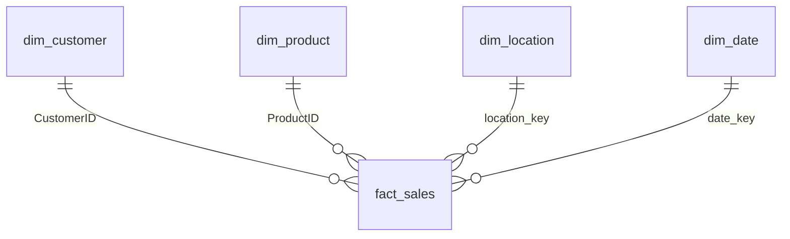

# Project Documentation

**Central Superstore – SQL Data Warehouse & Sales Analytics**

This document explains everything that was built in the project: the data warehouse, the analytical queries, the KPI objects, the optimization work, the Tableau dashboards, and the business findings. For a short overview and setup steps, see the [README](../README.md).

---

## Table of Contents

1. [Project Overview](#1-project-overview)
2. [Team and Supervision](#2-team-and-supervision)
3. [Dataset](#3-dataset)
4. [Tools and Environment](#4-tools-and-environment)
5. [Data Warehouse Architecture](#5-data-warehouse-architecture)
6. [Gold Layer: Star Schema](#6-gold-layer-star-schema)
7. [Business Queries](#7-business-queries)
8. [KPI View and Stored Procedure](#8-kpi-view-and-stored-procedure)
9. [Query Optimization](#9-query-optimization)
10. [Tableau Dashboards](#10-tableau-dashboards)
11. [Business Findings and Recommendations](#11-business-findings-and-recommendations)
12. [Challenges and Lessons Learned](#12-challenges-and-lessons-learned)
13. [Limitations and Future Work](#13-limitations-and-future-work)
14. [How to Reproduce](#14-how-to-reproduce)

---

## 1. Project Overview

**Goal:** turn a flat retail sales file into a structured analytical platform that answers three business questions:

- **Profitability:** which categories, sub-categories and products make or lose money, and why?
- **Customer behavior:** who are the most valuable customers and how do segments differ?
- **Sales trends:** how do sales and profit evolve over time, and how does fulfillment perform?

**Approach:**

1. Load the raw CSV into SQL Server and refine it through **staging → bronze → silver → gold** layers (medallion architecture).
2. Model the gold layer as a **star schema** (one fact table, four dimensions).
3. Write **15 analytical queries**, a **KPI view** and a **stored procedure**, and add **indexes** for performance.
4. Build **Tableau dashboards** on top of the gold layer to communicate the findings.

---

## 2. Team and Supervision

| Member | Contribution |
|---|---|
| Kirollos Gadallah | SQL data warehouse, *Sales & Profit Overview* dashboard, Tableau Story |
| Mariam Emad | *Product & Category Profitability* dashboard |
| Laila Elsisi | *Discounting & Margin Impact* dashboard |
| Basmala Esam | *Customer & Fulfillment Insights* dashboard |

Each member built an individual data warehouse in the first phase of the project. The warehouse in this repository is Kirollos's implementation, and the team's shared Tableau workbook is connected to its gold layer. The dashboards were then built collaboratively, one per member.

The project was carried out under the supervision of **Eng. Waleed Mohamed** within the **Digital Egypt Pioneers Initiative (DEPI)**.

---

## 3. Dataset

**File:** `data/Central_Superstore.csv` – the Central-region extract of a retail ("Superstore") sales dataset, covering orders from **2013 to 2016**. Each row is one **order line item** (one product within an order).

| Column | Description |
|---|---|
| `RowID` | Unique row identifier (used as the silver-layer primary key) |
| `OrderID` | Order number; one order can contain several lines |
| `OrderDate`, `ShipDate` | Date the order was placed and shipped |
| `ShipMode` | Standard Class, Second Class, First Class, Same Day |
| `CustomerID`, `CustomerName` | Customer identifier and name |
| `Segment` | Consumer, Corporate, Home Office |
| `Country`, `City`, `State`, `PostalCode`, `Region` | Delivery location |
| `ProductID`, `ProductName` | Product identifier and name |
| `Category`, `SubCategory` | Furniture / Office Supplies / Technology and their 17 sub-categories |
| `Sales` | Line revenue |
| `Quantity` | Units sold |
| `Discount` | Discount rate applied (0–1) |
| `Profit` | Line profit (can be negative) |

---

## 4. Tools and Environment

| Tool | Use |
|---|---|
| SQL Server Express (`localhost\SQLEXPRESS`) | Database engine, database name `central_dw` |
| VS Code + MSSQL extension | Writing and running T-SQL |
| Tableau Desktop / Tableau Public | Dashboards and publishing |
| Git & GitHub | Version control and delivery |

---

## 5. Data Warehouse Architecture

```
CSV ─► staging ─► bronze ─► silver ─► gold ─► Tableau
```

All objects live in one database (`central_dw`) and are separated by schema: `staging`, `bronze`, `silver`, `gold`.

### 5.1 Staging – `staging.Superstore`

- Every column is `VARCHAR(250)` so that the load can never fail because of a bad value.
- Loaded with `BULK INSERT` (`FORMAT = 'csv'`, `FIELDQUOTE = '"'`, `FIRSTROW = 2`).
- The table is truncated before each load, so it always mirrors the latest file.

### 5.2 Bronze – `bronze.Superstore`

- Same raw text columns plus an identity key `bronze_id`.
- New rows are appended using `INSERT … SELECT … EXCEPT SELECT … FROM bronze`, so re-running the load **never inserts the same row twice**.
- Bronze keeps the full history of what was received.

### 5.3 Silver – `silver.superstore`

The silver layer holds clean, typed data with **one row per `RowID`** (primary key).

| Step | Technique |
|---|---|
| Skip blank orders | Rows with an empty `OrderID` are excluded |
| Standardize text | `LTRIM`/`RTRIM` + `NULLIF(…, '')` turns empty strings into `NULL` |
| Convert types | `TRY_CAST` to `DATE`, `INT` and `DECIMAL(10,2)` |
| De-duplicate | `ROW_NUMBER() OVER (PARTITION BY RowID ORDER BY bronze_id DESC)` keeps the latest version of each row |
| Load | `MERGE` upserts into silver on `RowID` (update if matched, insert if not) |

**Data-quality flags** (built with `CASE`; rows are flagged, never deleted):

| Flag | Rule |
|---|---|
| `has_missing_value` | Any business column is `NULL` after cleaning |
| `has_invalid_value` | `Sales`, `Quantity` or `Discount` is negative |
| `has_outlier_value` | `Sales` or `Profit` is outside the **IQR fences** (Q1 − 1.5·IQR, Q3 + 1.5·IQR), computed with `PERCENTILE_CONT` |

### 5.4 Gold

The gold layer is the star schema described next. It is built from silver and is the only layer used by queries and Tableau.

---

## 6. Gold Layer: Star Schema



**Grain of the fact table:** one row per order line item (one `RowID`).

### 6.1 Tables

| Table | Key | Main columns |
|---|---|---|
| `gold.dim_customer` | `CustomerID` (PK) | `CustomerName`, `Segment` |
| `gold.dim_product` | `ProductID` (PK) | `ProductName`, `Category`, `SubCategory` |
| `gold.dim_location` | `location_key` (PK, identity) | `Country`, `City`, `State`, `PostalCode`, `Region` |
| `gold.dim_date` | `date_key` (PK, identity) | `OrderDate` and `ShipDate`, each with day, month, month name, quarter, year and weekday |
| `gold.fact_sales` | `sales_key` (PK, identity) | `RowID`, `OrderID`, `CustomerID` (FK), `ProductID` (FK), `location_key` (FK), `date_key` (FK), `ShipMode`, `Sales`, `Quantity`, `Discount`, `Profit` |

All four foreign keys are enforced with constraints (`FK_fact_customer`, `FK_fact_product`, `FK_fact_location`, `FK_fact_date`).

### 6.2 Design decision: one combined date dimension

Instead of a generic calendar referenced twice (order date and ship date), `dim_date` stores **one row per distinct (OrderDate, ShipDate) pair**, with attributes for both dates. As a result:

- `fact_sales` carries a **single `date_key`** and a single date foreign key.
- Shipping time can be computed with no second join: `DATEDIFF(DAY, OrderDate, ShipDate)`.
- Trade-off: it is less flexible than a conformed calendar dimension (for example, it is not a full calendar with every date), but it keeps the model simple and fits this dataset well.

### 6.3 Loading order

Dimensions are loaded first, then the fact table looks up each surrogate/business key by joining back to the dimensions (location and date are matched on their attribute values). Tables are dropped in reverse dependency order (fact first, then dimensions) so that foreign keys never block a rebuild.

---

## 7. Business Queries

All 15 queries run against the gold layer and are in the *"15 Query"* section of `SQL/retail.sql`.

| # | Business question | Techniques |
|---|---|---|
| Q1 | Total sales and profit by category | JOIN, GROUP BY |
| Q2 | Top 10 customers by total sales | JOIN, TOP |
| Q3 | Sales and profit by region | JOIN, GROUP BY |
| Q4 | Sales trend by year and month | JOIN, GROUP BY |
| Q5 | Average discount per shipping mode | JOIN, AVG |
| Q6 | Top 5 most profitable products within each category | CTE, `ROW_NUMBER() OVER (PARTITION BY …)` |
| Q7 | Customers whose sales exceed the average customer | CTE, scalar subquery |
| Q8 | Month-over-month sales growth | CTE, `LAG()` |
| Q9 | Profit margin % by sub-category | CTE, `CAST` |
| Q10 | Products selling above the average product total | JOIN, subquery in `HAVING` |
| Q11 | Customers who never ordered in the West region | `NOT IN` subquery |
| Q12 | Highest single sale in each state | Correlated subquery |
| Q13 | Average days from order to shipment per ship mode | JOIN, `DATEDIFF`, decimal `AVG` |
| Q14 | Top category for each customer segment | CTE, `RANK()`, 2 JOINs |
| Q15 | Loss-making order lines with full details | 4 JOINs |

**Requirements coverage**

| Requirement | Delivered |
|---|---|
| Relational tables | 5 in the gold star schema (+ staging, bronze, silver) |
| Queries | 15 |
| JOINs | Used throughout (up to 4 in a single query) |
| CTEs | 5 in the business queries, plus several in the ETL |
| Subqueries | Scalar, `NOT IN`, and correlated |
| `CASE` statements | 3 (data-quality flags) |
| View | `gold.category_kpi` |
| Stored procedure | `gold.usp_get_region_kpi` |
| Keys | Primary and foreign keys on every gold table |

---

## 8. KPI View and Stored Procedure

### `gold.category_kpi` (view)

Returns one row per category with `TotalSales`, `TotalProfit`, `TotalQuantity` and `ProfitMargin` (profit ÷ sales, as a percentage).

```sql
SELECT * FROM gold.category_kpi;
```

| Category | TotalSales | TotalProfit | TotalQuantity | ProfitMargin % |
|---|---:|---:|---:|---:|
| Office Supplies | 167,026.33 | 8,604.85 | 5,409 | 5.15 |
| Furniture | 163,797.26 | −2,894.75 | 1,827 | −1.77 |
| Technology | 170,416.29 | 28,718.84 | 1,544 | 16.85 |

### `gold.usp_get_region_kpi` (stored procedure)

Returns `OrderCount`, `TotalSales`, `TotalProfit` and `ProfitMarginPct` per region. The optional `@Region` parameter filters to a single region; when omitted, all regions are returned. The aggregation logic is written once and reused by every call.

```sql
EXEC gold.usp_get_region_kpi;                      -- all regions
EXEC gold.usp_get_region_kpi @Region = 'Central';  -- one region
```

Central region result: **$501,239.88 in sales and $34,428.94 in profit** (about a 6.9% margin).

---

## 9. Query Optimization

Five non-clustered indexes were added on the fact table:

| Index | Column | Supports |
|---|---|---|
| `IX_fact_sales_OrderID` | `OrderID` | Order-level lookups and grouping |
| `IX_fact_sales_CustomerID` | `CustomerID` | Joins to `dim_customer` |
| `IX_fact_sales_ProductID` | `ProductID` | Joins to `dim_product` |
| `IX_fact_sales_location_key` | `location_key` | Joins to `dim_location` |
| `IX_fact_sales_date_key` | `date_key` | Joins to `dim_date` |

**Why these indexes:** `fact_sales` is the largest table and sits on the many side of every join, so each foreign-key column is the join column for several queries. Indexes let SQL Server seek to matching rows instead of scanning the whole fact table.

**Load-then-index:** indexes are created *after* the fact table is populated. Building them once on loaded data avoids paying index-maintenance cost on every inserted row.

**Other design choices that help performance:**

- The star schema keeps every analytical query to at most one join per dimension.
- Data types are tightened in silver (`DATE`, `INT`, `DECIMAL`) instead of staying as text.
- Combining order and ship dates in one dimension removed a join from every shipping-time query.

---

## 10. Tableau Dashboards

The workbook `Tableau/Mini Project Tableau.twbx` connects to the gold layer (`fact_sales` joined to the four dimensions) and is packaged with a data extract. It contains **19 worksheets, 4 dashboards and a Story**, published on [Tableau Public](https://public.tableau.com/app/profile/kirollos.gadallah/viz/CentralRetailDataset/ProductCategoryProfitability).

### 10.1 Shared features

- **Select Year parameter** (2013–2016): drives current-year (CY) vs previous-year (PY) calculations on the KPI cards and trend lines.
- **Filter panel** (collapsible): Segment, Ship Mode, Category, Sub-Category, State, City.
- **Navigation buttons** at the top of every dashboard.
- **Profit-aware colors:** green for profit, red for loss.

### 10.2 Key calculated fields

| Field | Purpose |
|---|---|
| `CY Sales / Profit / Quantity` and `PY …` | Value for the selected year and the year before |
| `% Diff Sales / Profit / Quantity` | Year-over-year change |
| `Profit Margin` | `SUM(Profit) / SUM(Sales)` |
| `Average Order Value` | `SUM(Sales) / COUNTD(OrderID)` |
| `Orders per Customer` | `COUNTD(OrderID) / COUNTD(CustomerID)` |
| `Profit per Customer` | `SUM(Profit) / COUNTD(CustomerID)` |
| `Shipping Days` | `DATEDIFF('day', OrderDate, ShipDate)` |
| `Profit (+)` / `Profit (−)` | Split profit by sign for conditional coloring |
| `Order Line` | `OrderID + " | " + ProductName` for the loss-making table |

### 10.3 Dashboards

**1. Sales & Profit Overview** (Kirollos Gadallah)
KPI cards (Total Sales, Total Profit, Total Quantity) with year-over-year change and monthly CY-vs-PY sparklines; a weekly sales and profit trend with average reference lines; sales and profit by category; and a map of profitability by state.

**2. Product & Category Profitability** (Mariam Emad)
Profit by sub-category (diverging green/red bars); top 10 most profitable products; monthly profit-margin trend for each category; and a treemap of sales by sub-category.

**3. Discounting & Margin Impact** (Laila Elsisi)
Profit by discount level; average discount by sub-category; a state map comparing margin with and without discount; and a table of the biggest loss-making order lines.

**4. Customer & Fulfillment Insights** (Basmala Esam)
Top 10 customers by sales; segment performance (average order value, orders per customer, profit per customer); average shipping time by ship mode; order volume by ship mode over time; and a customer/order geography map.

**Tableau Story** (Kirollos Gadallah)
A Tableau Story is included in the workbook alongside the four dashboards.

---

## 11. Business Findings and Recommendations

Figures cover 2013–2016 unless stated otherwise. Query numbers refer to Section 7; dashboard values are read from the published dashboards.

### 11.1 Profitability

- **Furniture is the only loss-making category:** −$2,894.75 on $163,797.26 of sales (−1.77% margin). Technology earns 16.85% on similar sales, and Office Supplies earns 5.15% *(Q1, `category_kpi`)*.
- **7 of 17 sub-categories lose money.** Furnishings (−$3,849), Tables (−$3,021), Appliances (−$2,639), Bookcases (−$1,998), Machines (−$1,486), Binders (−$987) and Supplies (−$657). Profitable sub-categories include Copiers ($15,501), Phones ($10,143), Paper ($6,872) and Chairs ($5,973) *(Q9, Dashboard 2)*.
- **Furniture's loss is a mix problem, not a category-wide one:** Chairs earn $5,973, but Furnishings, Tables and Bookcases lose more than that combined.
- **Copiers combine strong margin (~41.6%) with high sales** ($37.3K), making them the strongest sub-category *(Q9)*.
- **722 order lines** were sold at a loss *(Q15)*.

### 11.2 Discounting

- Profit is highest at **$71.6K with no discount**, and turns negative at roughly a **30% discount**, falling to about −$30K at 80% *(Dashboard 3)*.
- **The five most-discounted sub-categories are all unprofitable:** Binders (51% average discount), Appliances (45%), Furnishings (40%), Machines (33%) and Tables (26%) *(Dashboard 3)*.
- **First Class shipments carry the highest average discount (26.6%)**, compared with 24.1% for Standard Class, 22.5% for Second Class and 22.4% for Same Day *(Q5)*.

### 11.3 Customer behavior

- **Average order value is similar across segments** (Consumer $417, Corporate $454, Home Office $409), and customers place about 1.8–1.9 orders each.
- **Profit per customer differs sharply:** $16.7 for Consumers versus $98.6 for Corporate and $92.7 for Home Office *(Dashboard 4)*.
- **Purchasing preferences differ by segment:** Consumers spend most on Office Supplies; Corporate and Home Office spend most on Technology *(Q14)*.
- The top 10 customers on the dashboard range from about $3.9K to $12.2K in total sales.

### 11.4 Sales trends and fulfillment

- **2016 vs 2015:** sales were essentially flat (−0.22%), but profit fell **74.5%** to about $5K *(Dashboard 1)*.
- **Sales are volatile month to month** (for example, April 2013 fell $2,115 and June 2013 rose $5,598), so forecasting should use seasonal or multi-month averages *(Q8)*.
- **Strong autumn months:** September 2013 is the single largest month ($34.4K), and November is among the top months in both 2013 ($14.1K) and 2016 ($15.2K) *(Q4)*.
- **Average shipping time:** Standard Class 5.0 days, Second Class 3.4, First Class 2.2, Same Day 0.05 *(Dashboard 4)*.

### 11.5 Recommendations

1. **Cap discounts** above roughly 30%, with approval rules for the most-discounted sub-categories (Binders, Appliances, Furnishings, Machines, Tables).
2. **Fix Furniture's mix:** reprice or rationalize Furnishings, Tables and Bookcases while protecting profitable Chairs.
3. **Grow the winners:** invest in Copiers, Phones, Paper and Accessories.
4. **Investigate the 2016 profit drop** using the Select Year parameter and the discount and sub-category dashboards.
5. **Review First Class discounting**, since the fastest premium option carries the heaviest discounts.
6. **Segment strategy:** raise profit per Consumer customer (pricing and discount rules) and protect high-yield Corporate and Home Office accounts.
7. **Extend the warehouse** with the East, South and West regions for cross-region analysis.

---

## 12. Challenges and Lessons Learned

| Challenge | Resolution |
|---|---|
| Duplicate primary-key errors in silver | A leftover silver table from an earlier iteration had a different key definition. Dropping and recreating it with `PRIMARY KEY (RowID)` fixed the problem. |
| `WITH` (CTE) syntax errors after a `CREATE TABLE` | A CTE must start its batch. A `GO` separator (and a leading `;`) before `WITH` solved it. |
| Could not drop a dimension table | Foreign keys block the drop. Tables are now dropped fact-first, then dimensions. |
| Q12 returned a single row instead of one per state | The correlated subquery reused the outer alias, so it compared a table to itself. Giving the inner query its own aliases (`f2`, `l2`) restored the correlation. |
| Q6 returned only one category | `TOP (5)` inside the CTE limited rows *before* the window function partitioned by category. Removing it and filtering with `WHERE rnk <= 5` in the outer query fixed it. |
| Q13 shipping times were rounded | `AVG` over an integer returns an integer. Casting the day difference to `DECIMAL(10,2)` returns precise averages that match the dashboard. |
| Order and ship dates needed two joins | Redesigned `dim_date` to hold both dates in one row with a single `date_key`. |

---

## 13. Limitations and Future Work

**Limitations**

- Only the **Central region** is loaded, so cross-region questions (such as Q11) are not meaningful yet.
- Outliers are flagged but not removed or treated.
- The `BULK INSERT` file path is machine-specific.
- The Tableau workbook ships with an extract, so numbers update only when it is refreshed against the database.

**Future work**

- Load the East, South and West regional files into the same pipeline.
- Wrap the full refresh (staging → gold) in a single stored procedure and schedule it with SQL Server Agent.
- Add an incremental fact load instead of a full rebuild.
- Capture before/after **execution plans** to quantify the impact of the indexes.
- Add automated data-quality checks (row counts per layer, orphan-key checks).

---

## 14. How to Reproduce

1. Install SQL Server (Express is enough) and a SQL client.
2. Clone this repository and open `SQL/retail.sql`.
3. Edit the `BULK INSERT` path to point to `data/Central_Superstore.csv`.
4. Run the script top to bottom to build `central_dw` (staging → bronze → silver → gold, indexes, view, procedure and the 15 queries).
5. Validate the load:
   ```sql
   SELECT COUNT(*) FROM silver.superstore;
   SELECT COUNT(*) FROM gold.fact_sales;   -- should match silver
   SELECT * FROM gold.category_kpi;
   ```
6. Open `Tableau/Mini Project Tableau.twbx`, or view the published dashboards on Tableau Public.
